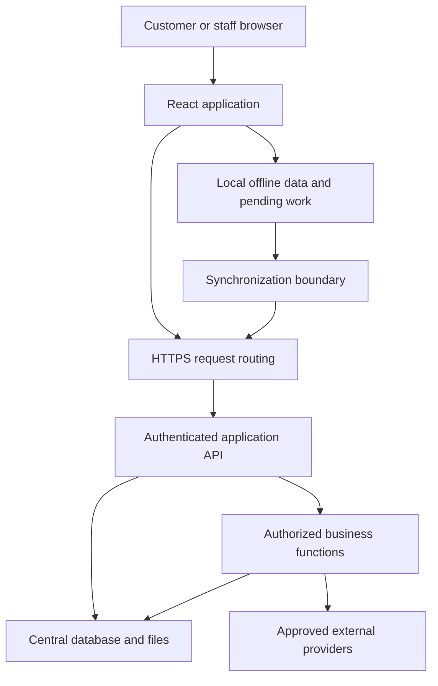

# Architecture and technology

[Back to the Developer Hub](../README.md)

## Logical architecture

The diagram shows responsibility boundaries, not a deployment map. Hostnames, infrastructure addresses, credentials, service ports, and filesystem layouts are intentionally omitted.

The server remains responsible for accepting shared business changes. Local persistence improves continuity; it does not make a browser authoritative over other businesses, payment processors, or central records.

## Systems and their jobs

| Technology or system | Role in Hubzam Works | What it does not establish by itself |
|---|---|---|
| Ubuntu Linux | Operating environment for deployed application services | A security certification or availability guarantee |
| Nginx | Web serving and request routing | Business authorization |
| React | Interactive browser interface | Trusted enforcement of privileged actions |
| JavaScript / TypeScript | Application languages and development-time type support | Runtime validation of untrusted requests |
| Vite | Frontend build and asset packaging | The business API server |
| Tailwind CSS / Radix UI | Layout, styling, dialogs, menus, and accessible UI primitives | Complete accessibility conformance without testing |
| React Router | Client-side navigation | Permission to access a route's underlying data |
| TanStack Query | Server-data fetching and cache coordination | The durable offline business database |
| Node.js / Hono | Main application API runtime and HTTP request handling | Permission for every caller to invoke every function |
| Deno | Separate business-function runtime | A publicly licensed function SDK |
| PostgreSQL | Central persistent application data | Proof that every multi-step workflow is atomic |
| SQLite WASM / OPFS | Browser-local structured persistence for supported offline workflows | Unlimited storage or supported behavior in every browser |
| IndexedDB | Supporting local persistence, journals, caches, and fallback mechanisms | A cloud backup |
| Service Worker / Cache Storage | Offline application assets and navigation support | Offline availability of third-party services |
| Hubzam synchronization layer | Submission and reconciliation of eligible local work | Guaranteed immediate convergence during an outage |
| Managed file storage | Product images and other application files | A public right to download private uploads |
| systemd | Lifecycle supervision of deployed services | A complete disaster-recovery strategy |
| Git / GitHub | Version history, change review, and release coordination | Public access to private application repositories |
| SentinelX | Authorized remote operational administration | A customer integration endpoint |

A targeted server inspection confirmed the core API, function runtime, web routing, database, and mail relay services running at the documentation baseline. Dependency declarations identify supporting libraries; installed packages do not prove that every library is exercised on every screen.

## Supporting libraries

Recharts supports charting; React Hook Form and Zod support form and input handling; Sharp and React Easy Crop support image-processing and image-editing capabilities. jsPDF and html2canvas support document-related output. Barcode and QR libraries support code generation and display. Stripe libraries support payment-provider integration.

## Separation of responsibilities

The browser presents forms and workflow context. The API resolves identity and business access. Business functions implement authorized domain operations. The database and file layer persist accepted state. Provider adapters handle capabilities such as payments and email.

Backend secrets are not part of the frontend bundle. Public documentation explains this boundary without publishing secret values, service accounts, private network topology, or operational commands.

## What independent hosting means

Hubzam Works runs on owner-managed VPS infrastructure rather than the former hosted application platform. Independent hosting gives the operator responsibility for releases, updates, credentials, monitoring, storage, and recovery. It does not mean the product is open source, that every component is proprietary, or that external payment and communication providers are unnecessary.
