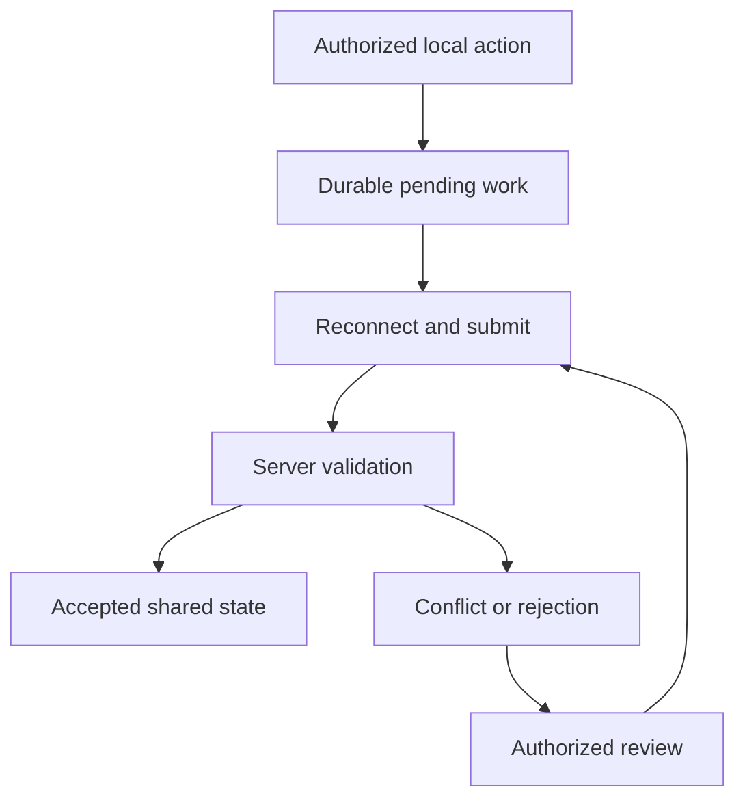

# Offline operation and synchronization

[Back to the Developer Hub](../README.md)

## Offline-first is a bounded capability

Hubzam Works is browser-first. Supported offline POS workflows use local persistence and synchronization rather than a required desktop executable.

Offline operation does not mean that every screen, external integration, payment method, or administrative task can work without connectivity. A device needs the appropriate cached application, local data, authorization, and browser capabilities before an outage.

## Components

SQLite WASM and OPFS provide browser-local structured storage. A worker can own local database work so the interface stays responsive. IndexedDB supports journals, caches, and fallback mechanisms. A service worker and Cache Storage make selected application assets available without repeatedly retrieving them.

The synchronization layer submits eligible pending work to the central service. PostgreSQL holds accepted shared state. The boundary between a local action and accepted central state is deliberately visible in the domain model.

## Transaction lifecycle

This is a conceptual lifecycle. It is not a serialization format, an implementation algorithm, or a guarantee that each release uses these exact labels.

A local action should not be described as centrally synchronized until the service acknowledges it. A conflict is an explicit business outcome requiring appropriate handling, not necessarily a transport error.

## Conflicts and concurrent work

Two devices can act on different snapshots of inventory or account state. Reconciliation needs to distinguish duplicate submission, a stale revision, and an operation that is no longer authorized or valid.

Revision-aware inventory operations and offline conflict review/resolution routes exist. Their private reconciliation rules and payload formats are not disclosed here. Integrators must obtain the applicable operation contract rather than inventing a last-write-wins policy.

Do not promise exactly-once delivery or universal automatic conflict resolution from the presence of these mechanisms.

## Authentication while disconnected

Offline authorization is distinct from an ordinary online session. Signed, bounded authorization mechanisms are present, but exact grant formats and validation internals remain private. A device cannot be assumed to learn a new revocation while it cannot contact the server.

## Payment limitation

Recording a sale offline is different from processing a card offline. Processor support, terminal hardware, merchant configuration, and risk rules all matter. The existence of terminal-related offline routes is not a promise that a browser or every reader accepts offline card payments.

## Device and storage limitations

Browser compatibility, quotas, permissions, storage clearing, and device health affect availability. Local persistence is not a backup. Reopening a tab on a new computer does not transfer the previous computer's unsynchronized queue.

Contributors should test supported workflows under interruption, reconnect, expired authorization, storage failure, and duplicate submission conditions in an approved environment using fictional data.
